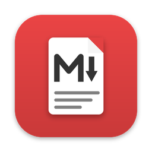
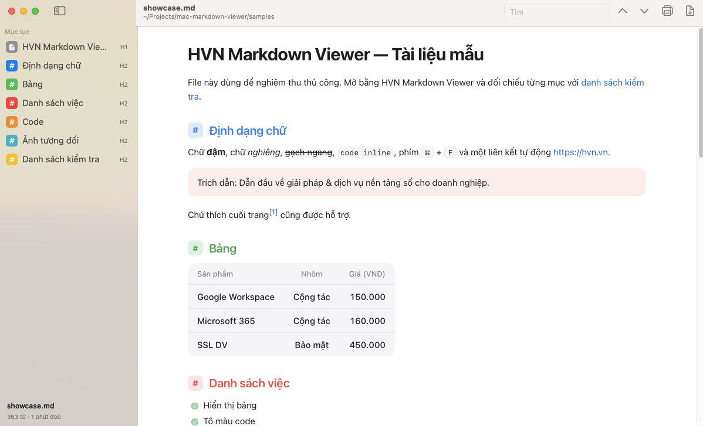

# HVN Markdown Viewer

**Xem file Markdown đẹp và nhanh trên Mac chip Apple và Windows — nhẹ, hoạt động offline, tự cập nhật.**

[**Tải về**](#tải-về) · [Có gì mới](https://github.com/hvngroup/universal-mder-app-releases/releases) · Hướng dẫn sử dụng: [macOS](docs/user-guide.md), [Windows](docs/user-guide-windows.md) · [Cập nhật](#cập-nhật) · [Hỗ trợ](#hỗ-trợ)

---

Đây là trang phát hành chính thức của HVN Markdown Viewer: bộ cài, ghi chú phát hành, hướng dẫn sử dụng và nơi báo lỗi. Mã nguồn do HVN GROUP quản lý riêng.

HVN Markdown Viewer là ứng dụng cho macOS và Windows chỉ để **xem** file Markdown: mở file, đọc, tìm, in. Muốn sửa nội dung, mở file bằng editor quen dùng — app tự hiển thị lại khi file được lưu.

- **GitHub Flavored Markdown:** bảng, task list, gạch ngang, chú thích cuối trang, tự nhận link, tô màu code.
- **Tự tải lại** khi file được sửa bằng editor khác, giữ nguyên vị trí đang đọc.
- **Thanh bên mục lục:** bấm để nhảy tới heading.
- **Tìm kiếm** (⌘F, ⌘G), **xuất PDF** (⇧⌘E), **in** (⌘P); trên Windows: Ctrl+F, F3, Ctrl+Shift+E, Ctrl+P.
- **Quick Look** (macOS): bấm phím Space trên file `.md` trong Finder để xem nhanh.
- **Tiếng Việt** mặc định (đổi được sang English), tự theo chế độ Sáng/Tối.
- **Riêng tư:** hoạt động offline, không gửi nội dung tài liệu đi đâu; chỉ kết nối mạng để tải ảnh `http(s)` có trong tài liệu và kiểm tra bản cập nhật.

  <picture>
    <source media="(prefers-color-scheme: dark)" srcset="docs/screenshots/viewer-dark.png">
    
  </picture>

## Tải về

| Hệ thống | File |
|:---|:---|
| **macOS 13 Ventura trở lên**, chip Apple (M1 trở lên) | [**HVN-Markdown-Viewer.dmg**](https://github.com/hvngroup/universal-mder-app-releases/releases/latest/download/HVN-Markdown-Viewer.dmg) — bộ cài |
| | [HVN-Markdown-Viewer.zip](https://github.com/hvngroup/universal-mder-app-releases/releases/latest/download/HVN-Markdown-Viewer.zip) — app nén sẵn, giải nén rồi kéo vào Applications |
| **Windows 10/11**, 64-bit | [**HVN-Markdown-Viewer-windows-x64-setup.exe**](https://github.com/hvngroup/universal-mder-app-releases/releases/latest/download/HVN-Markdown-Viewer-windows-x64-setup.exe) — bộ cài, không cần quyền quản trị |
| | [HVN-Markdown-Viewer-windows-x64-portable.zip](https://github.com/hvngroup/universal-mder-app-releases/releases/latest/download/HVN-Markdown-Viewer-windows-x64-portable.zip) — chạy không cần cài, không tự cập nhật |

Mỗi file có kèm mã kiểm tra `.sha256`. Mọi phiên bản và ghi chú phát hành: [Releases](https://github.com/hvngroup/universal-mder-app-releases/releases).

### Cài đặt trên macOS

1. Mở file `.dmg`, kéo **HVN Markdown Viewer** vào **Applications**.
2. Mở app từ **Applications**. App được ký Developer ID của HVN GROUP và đã qua kiểm tra của Apple (notarize), nên macOS chỉ hỏi xác nhận mở một app tải từ Internet: bấm **Open**.

**Mở mọi file `.md` bằng app:** chuột phải một file `.md` → **Get Info** → **Open with** → chọn HVN Markdown Viewer → **Change All…**.

**Quick Look:** mở app ít nhất một lần sau khi chép vào **Applications**. Nếu bấm Space trên file `.md` vẫn chưa thấy bản xem trước đã render, chạy `qlmanage -r` và kiểm tra **System Settings → General → Login Items & Extensions → Quick Look** đã bật HVN Markdown Viewer.

Chi tiết: [Hướng dẫn sử dụng cho macOS](docs/user-guide.md).

### Cài đặt trên Windows

1. Chạy `HVN-Markdown-Viewer-windows-x64-setup.exe`. Bộ cài chưa được ký số, nên lần đầu Windows có thể hiện **Windows protected your PC**: bấm **More info → Run anyway**.
2. Bộ cài gắn app với file `.md`, `.markdown`; nhấp đúp file là mở. App cần WebView2 (có sẵn trên Windows 11 và Windows 10 đã cập nhật; bộ cài tự tải nếu thiếu).

Chi tiết: [Hướng dẫn sử dụng cho Windows](docs/user-guide-windows.md).

## Cập nhật

App tự tìm bản mới tại trang này:

- **macOS:** chọn **HVN Markdown Viewer → Kiểm tra cập nhật…**, hoặc bật **Tự động kiểm tra bản cập nhật** trong **Cài đặt** (⌘,). Bấm **Install Update** để tải, cài và mở lại.
- **Windows (bản cài bằng bộ cài):** **⋯ → Kiểm tra cập nhật…**, hoặc bật **Tự động kiểm tra bản cập nhật** trong **Cài đặt** (Ctrl+,). Bấm **Cài đặt và khởi động lại**. Bản portable chỉ báo có bản mới và mở trang tải về.

Bản cập nhật chỉ được cài khi có chữ ký số khớp với khoá của HVN GROUP.

> **Đang dùng bản 1.4.0 trở về trước?** Các bản này tìm cập nhật ở địa chỉ cũ nên không tự cập nhật được nữa. Hãy tải và cài bản mới một lần theo mục [Tải về](#tải-về); cài đè lên bản cũ, cài đặt của anh/chị được giữ nguyên. Từ đó trở đi app tự cập nhật.

## Hỗ trợ

- **Báo lỗi hoặc đề xuất tính năng:** [Issues](https://github.com/hvngroup/universal-mder-app-releases/issues/new/choose). Không dán tài liệu chứa thông tin nội bộ hay dữ liệu khách hàng.
- **Lỗ hổng bảo mật:** gửi riêng theo [SECURITY.md](SECURITY.md), không mở issue công khai.
- **Hỗ trợ kỹ thuật:** [kythuat@hvn.vn](mailto:kythuat@hvn.vn) · 024.9999.7777

---

HVN GROUP · hvn.vn
